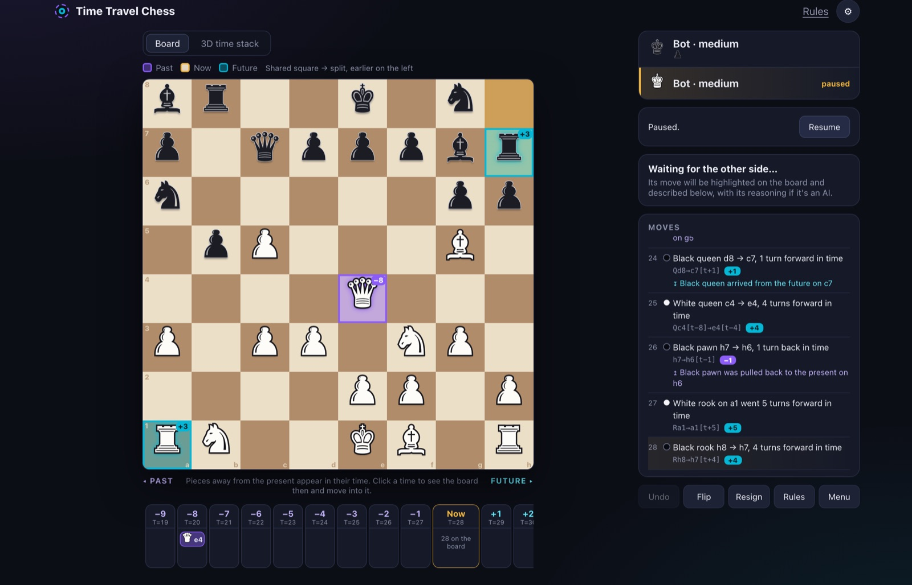
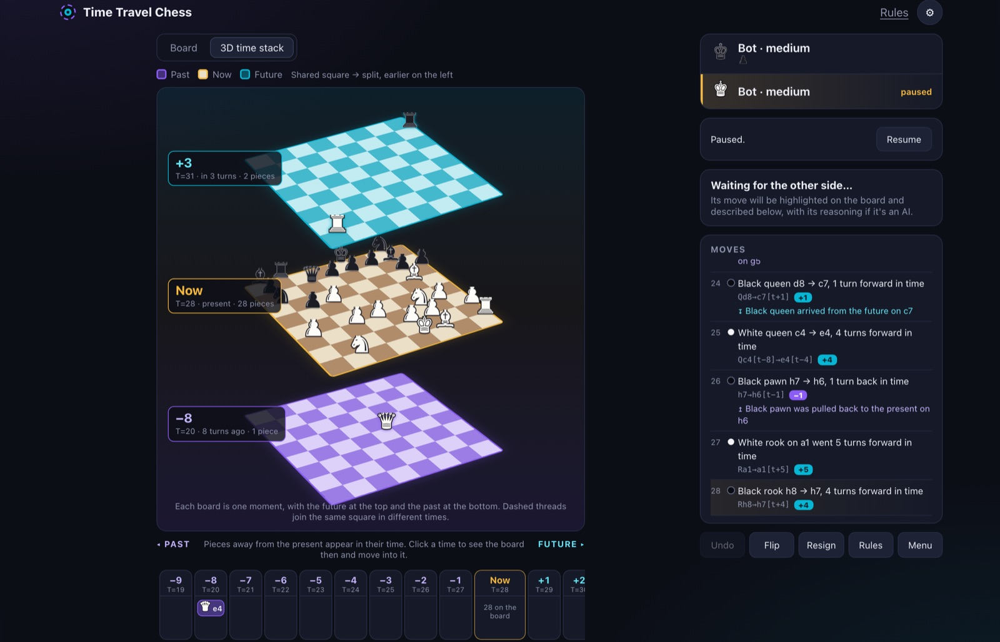
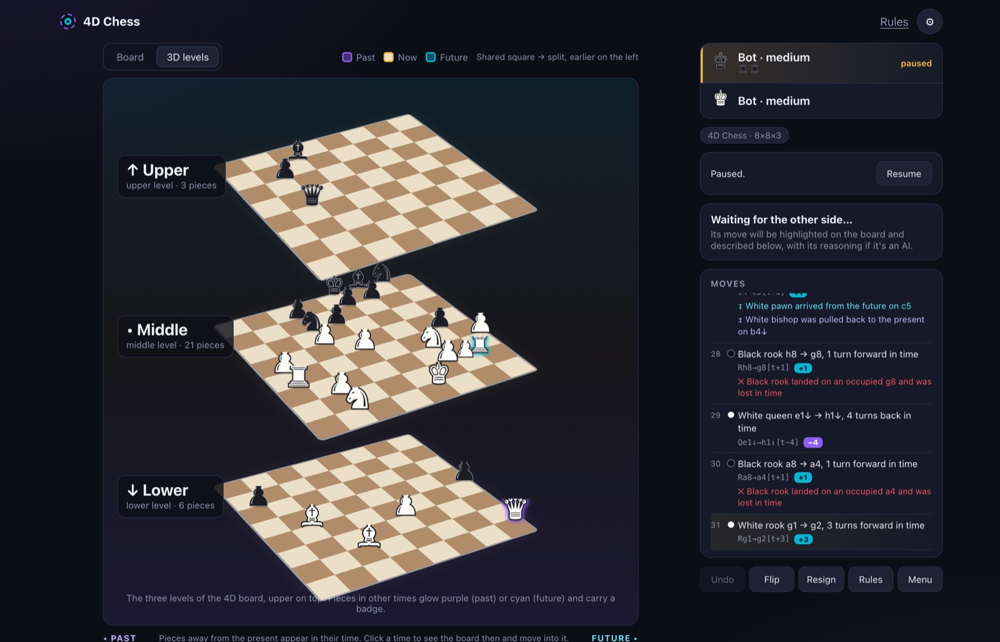
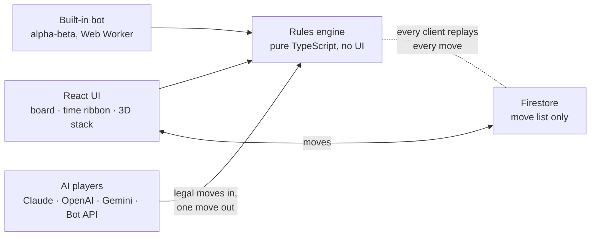

# 4D Chess

**Chess through time and space. Play it at [four-d-chess.web.app](https://four-d-chess.web.app).**

Two games in one:

- **Time Travel Chess**: the normal 8×8 board plus time (3 dimensions).
- **4D Chess**: an 8×8 board with 3 levels of height, plus time (4 dimensions).

Pieces can jump into the past or the future, and two pieces can share a square as long as they're in
different times. Capture a piece in the past and it's erased from history: the game replays every move
since without it.



| 3D time stack | 4D Chess: three levels plus time |
| --- | --- |
|  |  |

Play against a built-in bot, a friend on the same screen, a friend online with a link, or an AI model of your
choice (Claude, ChatGPT, Gemini, OpenRouter, a local model, or your own bot over HTTP). You can also watch two AIs
play each other.

```bash
npm install
npm run dev      # http://localhost:5173
npm test         # rules engine tests
```

## How it works



- **The rules engine is pure TypeScript with no UI code** (`src/engine/game.ts`). The UI, the bot, the AI
  adapters and online play all go through the same `legalMoves` / `applyMove`, so there's one definition of
  what's legal.
- **A game is its move record.** The state keeps the starting pieces, every move played and a snapshot of
  the board after each turn. "Erasing a piece from history" removes it from that turn on and replays the record.
  Moves that no longer make sense are voided (crossed out in the move list) rather than deleted.
- **One board model for 2D and 3D.** A square is `level × 64 + rank × 8 + file`, and each piece stores its
  time as `dt`, an offset from the present. Time Travel Chess is simply the one-level case, so both games share
  the same move generation.
- **Rules are data.** The time limits, horizon, erase limits, history model and draw rule live in a `Rules`
  object. "Simple" vs "OG" rules and the house-rules editor are just different values, not separate code paths.
- **The bot runs in a Web Worker** (alpha-beta search with time limits per difficulty), so the board never
  freezes while it thinks.
- **AI models never invent moves.** They get the position as text plus the full list of legal moves, and must
  answer with one of them as JSON. A wrong answer gets one retry with feedback, then the built-in bot can step in.
- **Online play stores only the move list.** Firestore security rules enforce seats and turn order, and both
  players' apps replay every move through the engine and ignore anything illegal. There's no game server to
  run or pay for.
- **55 tests** cover the rules (time travel, arrivals, erasing history and replay), the AI prompts and
  provider request shapes.

### Design problems the rules had to solve

Time travel breaks chess in some fun ways. Each fix is now a rule (see "Rules as implemented"):

| Problem found in play | Fix |
| --- | --- |
| A king could keep hopping into the future and never be caught | **TTL is a horizon** (no piece can be further from the present than its time limit), and **time catches up** (a piece already in the future can't jump further ahead) |
| Hopping one turn ahead on the same square was a free pass | **No passing** |
| The hard bot parked its queen in the past and erased pieces endlessly | **Erase limits per piece type** (pawn 1 … king 8) |
| Pieces could be erased by an attacker that only arrived after the fact | **No ambushes from the past**: an erase only counts if the attacker was already there before the victim's turn |

## Rules as implemented

The time limits and future rules below apply to every rule set. How the **past** works is in "OG rules" further
down. **House rules** (in the menu) can change every time limit, switch between living and simple history, turn
time travel off, drop the horizon, allow passing and change the draw rule.

| Piece  | TTL back | TTL forward |
| ------ | -------- | ----------- |
| King   | 5        | 10          |
| Queen  | 9        | 9           |
| Rook   | 5        | 5           |
| Bishop | 3        | 3           |
| Knight | 3        | 3           |
| Pawn   | 1        | 1           |

- **A turn = one player's move.** A snapshot of the present board is taken after every turn. Time starts at
  T=0, so the first move can't go back in time. After it, T=1 and T=0 can be visited.
- **No passing.** A piece can't jump exactly one turn ahead on its own square (from the present or the future).
  The board would be unchanged once time moves on.
- **A move** is a normal chess move plus an optional time shift within the piece's TTL. A piece can also stay
  on its square and move only through time ("straight down through time").
- **Paths are checked in the piece's own time.** It slides through its own time, then drops into the target
  time. So a queen on d8 with d7/d6 empty now can land on d5 two turns ago, even if d7 was occupied back then.
- **TTL is also a horizon.** A piece can never be further from the present than its TTL. Without this, a king
  could keep hopping further into the future and never be reachable. (`TTL_IS_HORIZON` in `src/engine/game.ts`.)
- **Time catches up:** a piece already in the future can't jump further ahead (only move in space or back
  toward now). Otherwise kings escape forever by hopping forward, since only queens can reach that far.
- **The future:** a future piece gets one turn closer every turn. When it reaches the present, it's lost if
  anything is on its square. If that's your king, you lose. Moves that would lose your own king this way are illegal.
- **Capturing** means landing on an enemy piece in its own time, so the time gap must be within your TTL.
- **Check** is any enemy piece being able to capture your king, from any time. Checkmate works as usual.
- **Castling** happens within one time. **En passant** works only in the present. **Promotion** works in any time.
- **Draws:** stalemate, only kings left, or 150 turns without a capture or pawn move.

## OG rules (the standard rules)

The original idea: **living history**. These are the default; pick **Simple** in the menu for the easier version
where the past can be seen but not touched (past pieces only block squares, and travellers keep a fixed gap).

- Going back in time puts you on the **real board from then**: back to T=0 and every piece is in its starting
  position (on the middle level in 4D Chess).
- A piece that goes back **stays on that board** (it falls one turn further behind each turn). Once it's further
  back than its time travel limit it's **pulled back** to the present on the same square, and lost if that square is taken.
- Capturing a piece on a past board (not a king) **erases it from history** from that turn on. The game replays every
  move since without it: it vanishes from the present, anything it captured later comes back, and moves that no
  longer make sense didn't happen (crossed out in the move list).
- Each piece may only erase a limited number of times per game: **pawn 1, knight 3, bishop 3, rook 5, queen 5,
  king 8** (changeable in house rules). Counts are per piece; a promoted pawn keeps its count and takes the new limit.
- **No ambushes from the past:** you can only erase a piece if your attacker was already standing where it is now
  before that piece's last turn back then. A piece that escapes a threat straight away is safe; one left in danger
  through its turn can have its history undone.
- Clicking an enemy piece takes it normally, in its own time; erasing its past self is a separate choice (the × in
  the corner of its square, or the board from back then).
- Pieces on past boards don't move or attack; only pieces that travelled there act.
- Engine: every game keeps its move record; an erasure replays it (`replay()` in `src/engine/game.ts`).

## 4D Chess: height

- Three 8×8 levels (lower, middle, upper). Both armies start like normal chess on the middle level.
- Squares on other levels are written with an arrow: `e4↑` is the upper level, `e4↓` the lower one.
- Rook: along any one axis (file, rank, or straight up/down). Bishop: diagonals in any plane (two axes at
  once). Queen: rook + bishop + the 3D diagonals. King: one step in any of 26 directions. Knight: 2 along
  one axis and 1 along another.
- Square colours flip on each level (as in 3D chess: colour follows file + rank + level), so a bishop always
  stays on its colour, even when it changes level.
- Pawn: one rank forward, optionally also up/down a level. Two straight ahead on its first move.
  Captures one rank forward and one file sideways, on its level or one up/down.
- Castling stays on one level. En passant only on one level, in the present. Promotion on the last rank of any level.

## Customisation

- **Settings (⚙):** board theme, piece style (solid / classic / letters), time colours (incl. colour-blind
  and high-contrast), coordinates, animations, move hints, sounds, bot thinking time, turning the board for pass & play.
- **Menu:** game, opponent, clock (3+2, 5+3, 10+5, 30+0) and house rules.

## AI players

Pick **AI** in the menu to play an AI of your choice (**You vs AI**) or to watch two AIs play each other
(**AI vs AI**, with pause/resume). Each side can be:

| Player | What you need |
| --- | --- |
| Built-in bot | Nothing (easy / medium / hard) |
| Claude (Anthropic) | An Anthropic API key. Default model `claude-opus-5-5`; also Sonnet 5.5, Haiku 4.5, Fable 5.1. "Thinking" sets the effort. |
| ChatGPT (OpenAI) | An OpenAI API key (default `gpt-6.1-sol`) |
| Gemini (Google) | A Google AI Studio key (default `gemini-3.8-flash`) |
| OpenRouter | One key for hundreds of models (use the id from openrouter.ai/models) |
| Local model | An OpenAI-compatible server such as Ollama (`http://localhost:11434/v1`) or LM Studio. Ollama needs `OLLAMA_ORIGINS` to include this site's address. |
| Your own bot | A URL that speaks the Bot API below |

- **Keys stay in the browser.** They're sent only to the provider you pick, never to this site's server, and are
  remembered on the device only if "Remember API keys" is ticked. Each AI move is one request billed to your key.
- Language models get the rules, an ASCII picture of every level, the pieces away from the present, recent
  moves and the full list of legal moves, and must answer `{"move", "comment"}` JSON. Their comment shows in the
  move log. An illegal answer gets one retry with feedback. If it fails again (or the API errors), the game
  pauses and offers **Try again** or **Let the built-in bot move**.
- Claude uses the official Anthropic SDK (loaded only when a Claude player is in the game) with structured outputs
  and server-side refusal fallbacks (`fallbacks: "default"`).
- **Find my models** asks the provider which models your key can use (Gemini, OpenAI, OpenRouter, local) and
  fills in the list, so you don't have to guess model ids. Providers retire models: e.g. Gemini 2.5 is now limited
  to older accounts, so new keys need a Gemini 3 model such as `gemini-3.8-flash`.
- **Busy or rate-limited providers** (429 / 5xx, e.g. free Gemini keys) are retried briefly inside the request,
  then the game counts down and tries again by itself (10s, 20s, 30s, 45s, 60s, or longer if the provider asks),
  with **Try now** / **Let the built-in bot move**. A used-up daily allowance is reported straight away.
- **Test connection** in the menu makes one request to check the key/URL/model before you start.

### Bot API (your own bot)

The game `POST`s JSON to your URL on each of your bot's turns:

```json
{
  "protocol": "4d-chess-bot/1",
  "variant": "time",            // or "4d"
  "you": "white",
  "turn": 12,
  "position": "…the same text description language models get…",
  "legalMoves": ["e2→e4", "Ng1→f3[t+2]", "Qd1×d7[t−1]", "…"],
  "history": ["e2→e4", "d7→d5[t+1]", "…"],
  "state": { "…": "the full engine state, if you want to compute yourself" }
}
```

Reply with one of the legal moves (or its index), plus an optional comment:

```json
{ "move": "Ng1→f3[t+2]", "comment": "Developing into the future." }
{ "index": 17 }
```

Your server must allow cross-origin requests (send `Access-Control-Allow-Origin: *` and answer `OPTIONS`).
A local bot at `http://localhost:…` works from the live site in Chrome.

## Online play

Pick **Online** in the menu. You get a link (`?game=CODE`) to send a friend, and the game starts when they open it.
Moves sync live through Firebase (Firestore + anonymous sign-in). Clocks, draw offers, resigning, rematches
(colours swapped) and spectators (a third person with the link) all work. Reopening the link in the same
browser puts you back in your seat.

- `firestore.rules`: only the two players can change a game, a seat can only be taken while empty, a
  move can only be added by the side to move, one at a time, and moves already played can never be changed
  or removed. Both apps also replay every move through the rules engine and ignore anything illegal.
- Local testing without a Firebase project: `npm run emulators` (needs Java) and `npm run dev:online`, then
  open `http://localhost:5189` and `http://127.0.0.1:5189` as the two players (different addresses give
  different anonymous users).
- **Trust model (known limitation):** there's no game server, so the database trusts the two players' apps.
  The rules stop strangers, out-of-turn moves and rewriting history, but a player running a modified app
  could still declare a result (e.g. claim the other side resigned). That's fine for friendly games. For ranked play, a Cloud Function
  would replay each move through the engine before accepting it.

### Live site

**https://four-d-chess.web.app**, hosted on Firebase (its own hosting site, `four-d-chess`, in the
Firebase project `paytowingame-a2b6f`, which it shares with another of my projects).

- Config lives in `.env.local` (git-ignored); `.env.example` lists the keys.
- **Every push to `main` deploys automatically** (GitHub Actions: tests → build → Firebase Hosting).
  Pull requests get a temporary preview link. The build reads the Firebase web config from the repo's
  Actions variables, and deploys with the `FIREBASE_SERVICE_ACCOUNT_PAYTOWINGAME_A2B6F` secret.
- Manual deploy: `npm run deploy` (builds, then deploys the `four-d-chess` site + Firestore rules). Firestore
  rule changes still need this, since the GitHub deploy account can only publish the site.

## Layout

- `src/engine/game.ts`: rules engine (move generation, time travel, arrivals, check, notation)
- `src/engine/bot.ts`: alpha-beta bot; runs in a Web Worker (`bot.worker.ts`)
- `src/ai/`: AI players: prompt + move matching, Claude (Anthropic SDK), OpenAI-compatible, Gemini and Bot API adapters
- `src/ui/`: React UI: board with split time squares, level map (4D), time ribbon, "when?" picker,
  3D stack view, menu, house rules editor, settings

## Roadmap

1. ✅ Engine + board UI + bot + pass & play
2. ✅ 4D Chess (height), house rules, settings, clocks
3. ✅ Online games with friends through share links (Firebase)
4. Tune the bot's time-travel play, piece art

## About

Built by Henry Harnischmacher. I design and build systems for businesses through
[Strategy Led Technology](https://strategyledtechnology.vercel.app/?ref=github-4d-chess). Get in touch there if you'd
like something built.

## License

© 2026 Henry Harnischmacher. All rights reserved. The code is public to read and learn from, but not licensed
for reuse. See [LICENSE](LICENSE).
